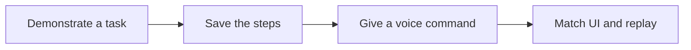
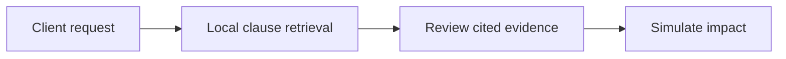
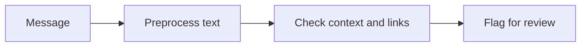
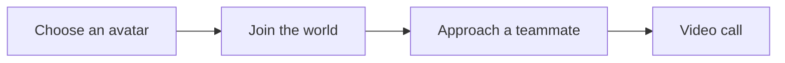
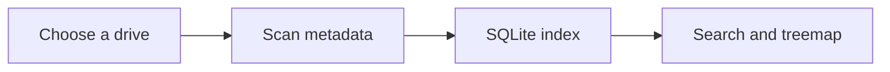
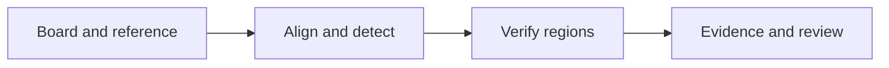
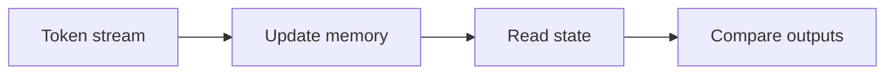
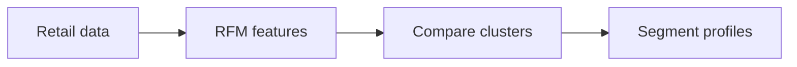

<h1 align="center">Ishpreet Singh Dhamija</h1>

<b>Computer Engineering student at Thapar</b> · machine learning, Android apps, and desktop software

Python and TypeScript · local inference · software projects

 

---

## Projects

### [Teachable Voice Automation](https://github.com/ISHPREET0101/prism-teachable-voice)

An Android assistant that learns a task from a demonstration and replays it from a spoken command. It combines local UI matching with model-assisted actions and asks for clarification when needed. Kotlin and Android accessibility APIs. A team project.

### [DeltaProof](https://github.com/sgoel2be24-cyber/deltaproof)

A team project for reviewing changes to a project scope. Local MiniLM embeddings find related clauses, show source citations, and support a cost and schedule simulation using reviewer estimates. TypeScript, Transformers.js and ONNX Runtime.

### SpamSentinel

A Python NLP project for flagging spam and phishing in multilingual and code-mixed messages. It uses message context and suspicious-link patterns, with separate preprocessing, inference, API and review components.

### [2D Metaverse](https://2d-metaverse-se.vercel.app/)

A shared virtual office where you choose an avatar and walk around with teammates. Move close to someone and a video call starts. The link opens the demo; the source is private.

### [BlockIT](https://github.com/ISHPREET0101/BlockIT)

A Windows storage explorer for finding files and seeing what's taking up disk space. Built with Electron, React, TypeScript and SQLite. [Download](https://github.com/ISHPREET0101/BlockIT/releases/latest).

### [CircuitSleuth](https://github.com/ISHPREET0101/circuitsleuth1)

A team project for PCB inspection using OpenCV. It compares a board against a reference, checks suspicious regions, and keeps the evidence for review. The documented benchmark uses synthetic boards.

### [Synapse Memory Lab](https://github.com/ISHPREET0101/synapse-memory-lab-dataforge-2026)

An interactive explanation of attention and memory, built as a team project for DataForge. Change decay or memory load and watch what happens in the toy simulations. [Open the labs](https://ishpreet0101.github.io/synapse-memory-lab-dataforge-2026/).

### [RetailPulse AI](https://github.com/ISHPREET0101/ML-PROJECT)

Retail customer segmentation using RFM features and clustering. The notebook covers data checks, model comparisons, and customer segment profiles.

[More repositories](https://github.com/ISHPREET0101?tab=repositories&type=public)

## Education and courses

**B.Tech. Computer Engineering, Thapar** · 2024–present 
**Finalist, DATA FORGE, IIT Kharagpur** · [Project](https://github.com/ISHPREET0101/synapse-memory-lab-dataforge-2026)

Completed these courses from DeepLearning.AI and Stanford Online on Coursera:

- [Supervised Machine Learning: Regression and Classification](https://coursera.org/verify/PYVPJPP6KXGL)
- [Advanced Learning Algorithms](https://coursera.org/verify/LYUZK160D8N7)
- [Unsupervised Learning, Recommenders, Reinforcement Learning](https://coursera.org/verify/PBVJQMLLHWXM)

## My contributions

Contribution snapshot: 29 October 2026. The snake is a decorative animation over the calendar.

## Toolkit

      

<b>AI and local inference</b>: embeddings, retrieval and model integration

NLP, sentence embeddings, semantic search, MiniLM, Transformers.js, ONNX Runtime, Android voice automation.

<b>Machine learning and data</b>: analysis, modelling and evaluation

pandas, NumPy, scikit-learn, PyTorch, OpenCV, Jupyter, RFM features and clustering.

<b>Backend, frontend and storage</b>: apps, APIs and databases

React, Electron, FastAPI, Flask, REST APIs, SQLite, Cloudflare D1, Drizzle ORM, HTML, CSS, Tailwind CSS and Android AccessibilityService.

<b>Development tools</b>: version control, workers and testing

Git, GitHub, Linux, Web Workers, Vite and Vitest.

