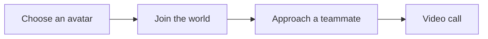
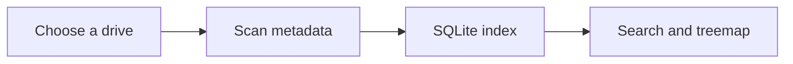
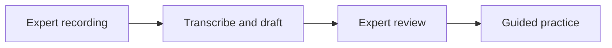
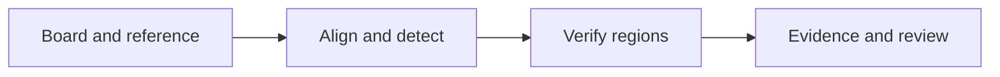
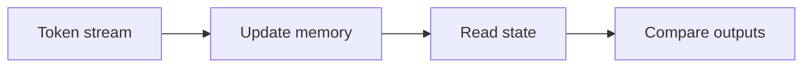
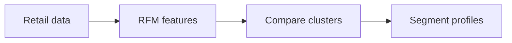

# Ishpreet Singh Dhamija

I'm a Computer Engineering student at **Thapar Institute of Engineering and Technology, Patiala**. I work with Python and TypeScript, mostly on machine learning projects, web apps, and desktop software.

This GitHub has a mix of coursework, hackathon projects, and apps I've worked on with teammates.

## 🔭 Currently

My focus is machine learning and software development. A few parts of that work:

- 🧠 Local inference and semantic search in [DeltaProof](https://github.com/sgoel2be24-cyber/deltaproof).
- 🛠️ Desktop tools, including [BlockIT](https://github.com/ISHPREET0101/BlockIT).
- 🌐 Interactive browser projects like [2D Metaverse](https://2d-metaverse-se.vercel.app/) and [Synapse Memory Lab](https://ishpreet0101.github.io/synapse-memory-lab-dataforge-2026/).

## Projects

### [2D Metaverse](https://2d-metaverse-se.vercel.app/)

A shared virtual office where you choose an avatar and walk around with teammates. Move close to someone and a video call starts. The link opens the demo; the source is private.

### [BlockIT](https://github.com/ISHPREET0101/BlockIT)

A Windows storage explorer for finding files and seeing what's taking up disk space. Built with Electron, React, TypeScript and SQLite. [Download](https://github.com/ISHPREET0101/BlockIT/releases/latest).

### [Takumi](https://github.com/ISHPREET0101/takumi)

Turns a recorded demonstration into a lesson that an expert can edit and approve, with guided practice for the learner. React frontend, Python/FastAPI backend. [Try the sample](https://takumi-two-kohl.vercel.app/); processing your own recordings needs the local backend.

### [CircuitSleuth](https://github.com/ISHPREET0101/circuitsleuth1)

A team project for PCB inspection using OpenCV. It compares a board against a reference, checks suspicious regions, and keeps the evidence for review. The documented benchmark uses synthetic boards.

### [Synapse Memory Lab](https://github.com/ISHPREET0101/synapse-memory-lab-dataforge-2026)

An interactive explanation of attention and memory, built as a team project for DataForge. Change decay or memory load and watch what happens in the toy simulations. [Open the labs](https://ishpreet0101.github.io/synapse-memory-lab-dataforge-2026/).

### [RetailPulse AI](https://github.com/ISHPREET0101/ML-PROJECT)

Retail customer segmentation using RFM features and clustering. The notebook covers data checks, model comparisons, and customer segment profiles.

## Tools I use

- **Languages:** Python, TypeScript, JavaScript, SQL, C++, C
- **ML and data:** pandas, NumPy, scikit-learn, PyTorch, OpenCV, Jupyter
- **Apps and APIs:** React, Electron, FastAPI, Flask, HTML/CSS, Tailwind
- **Storage and tooling:** SQLite, Cloudflare D1, Git, Linux, Vite, Vitest

I've also used Transformers.js and ONNX Runtime for local sentence embeddings and semantic search.

## Other projects I've worked on

- [DeltaProof](https://github.com/sgoel2be24-cyber/deltaproof) — team project for reviewing scope changes using local embeddings, source citations, and a cost/schedule simulator.
- [Teachable Voice](https://github.com/ISHPREET0101/prism-teachable-voice) — team project for teaching an Android task by demonstration and replaying it with a spoken command.
- [JOY PITWALL](https://github.com/ISHPREET0101/joy-pitwall) — an offline app for race-weekend plans, stint logs, and setup sheets.
- [Aegis Alpha](https://github.com/ISHPREET0101/alpaca-AI-Hackathon) — an options-agent project with risk checks and an audit log, built for paper trading.

[More repositories](https://github.com/ISHPREET0101?tab=repositories&type=public)

## Education and courses

**B.Tech. Computer Engineering, Thapar** · 2024–present 
**Finalist, DATA FORGE, IIT Kharagpur** · [Project](https://github.com/ISHPREET0101/synapse-memory-lab-dataforge-2026)

Completed these courses from DeepLearning.AI and Stanford Online on Coursera:

- [Supervised Machine Learning: Regression and Classification](https://coursera.org/verify/PYVPJPP6KXGL)
- [Advanced Learning Algorithms](https://coursera.org/verify/LYUZK160D8N7)
- [Unsupervised Learning, Recommenders, Reinforcement Learning](https://coursera.org/verify/PBVJQMLLHWXM)

## My contributions

Contribution snapshot: 29 October 2026. The snake is a decorative animation over the calendar.
