

  <picture><source media="(max-width: 600px)" srcset="assets/hero-mobile.svg" />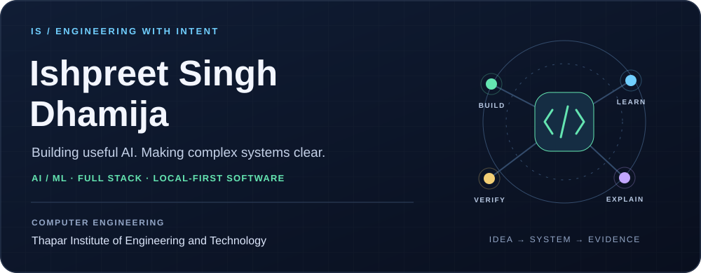</picture>

  <a href="https://www.linkedin.com/in/ishpreet-singh-351224322"><b>LinkedIn ↗</b></a> &nbsp; · &nbsp;
  <a href="#selected-work"><b>Selected work</b></a> &nbsp; · &nbsp;
  <a href="#how-the-projects-work"><b>System diagrams</b></a>

## A little about me

I'm **Ishpreet**, a Computer Engineering student at **Thapar Institute of Engineering and Technology, Patiala** (B.Tech., 2024–present). I build across **applied AI, machine learning, full-stack products, and desktop tools**.

I enjoy the part where a working model becomes a useful product: responsive interfaces, clear explanations, reliable data flows, and a person who can understand and review the result. My projects range from local semantic search and computer vision to storage explorers and interactive ML labs.

**Currently exploring:** evidence-backed AI workflows, local inference, and better ways to explain complex systems.  
**Happy to connect about:** AI/ML projects, engineering collaborations, and practical software problems.

## My toolkit

<picture><source media="(max-width: 600px)" srcset="assets/stack-mobile.svg" />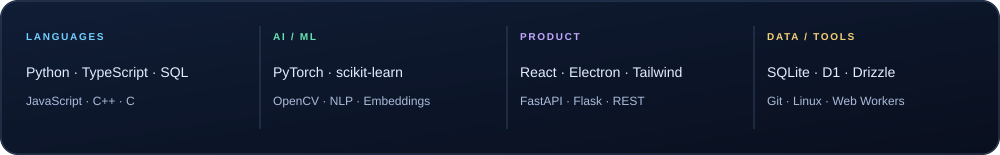</picture>

<b>The stack, in context</b>

| Area | Technologies I work with |
| :--- | :--- |
| Languages | Python, TypeScript, JavaScript, SQL, C++, C |
| Data science & ML | Pandas, NumPy, scikit-learn, PyTorch, Jupyter, NLP |
| Local AI & vision | Sentence embeddings, semantic search, Transformers.js, ONNX Runtime, OpenCV |
| Frontend & desktop | React, Electron, HTML, CSS, Tailwind CSS, Canvas |
| APIs & persistence | FastAPI, Flask, REST APIs, SQLite, Cloudflare D1, Drizzle ORM |
| Engineering tools | Git, GitHub, Linux, Web Workers, Vite, Vitest |

## Selected work

A few projects that show how I approach products, data, and engineering. Follow the links beneath each pair to explore the source and documentation.

<picture><source media="(max-width: 600px)" srcset="assets/gallery-1-mobile.svg" />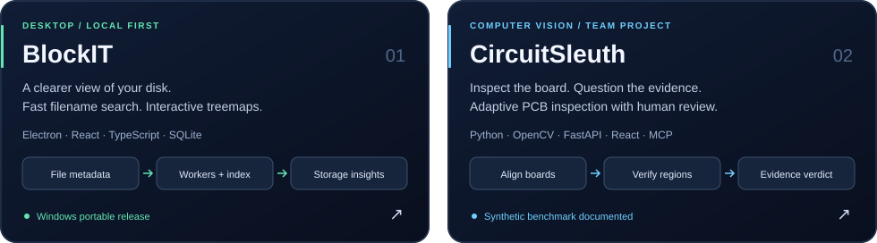</picture>

<a href="https://github.com/ISHPREET0101/BlockIT"><b>BlockIT ↗</b></a> &nbsp; · &nbsp; <a href="https://github.com/ISHPREET0101/circuitsleuth1"><b>CircuitSleuth ↗</b></a>

<picture><source media="(max-width: 600px)" srcset="assets/gallery-2-mobile.svg" />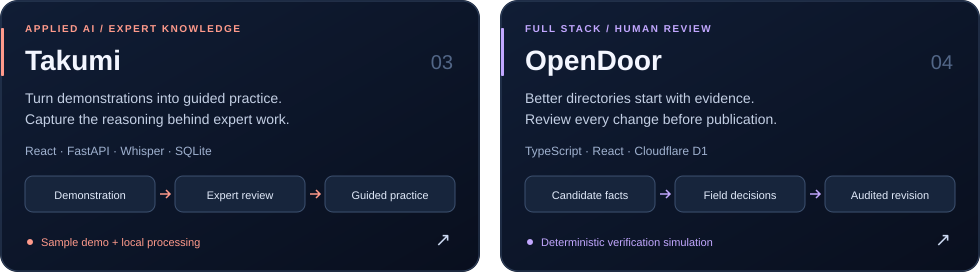</picture>

<a href="https://github.com/ISHPREET0101/takumi"><b>Takumi ↗</b></a> &nbsp; · &nbsp; <a href="https://github.com/ISHPREET0101/opendoor-calle"><b>OpenDoor ↗</b></a>

<picture><source media="(max-width: 600px)" srcset="assets/gallery-3-mobile.svg" />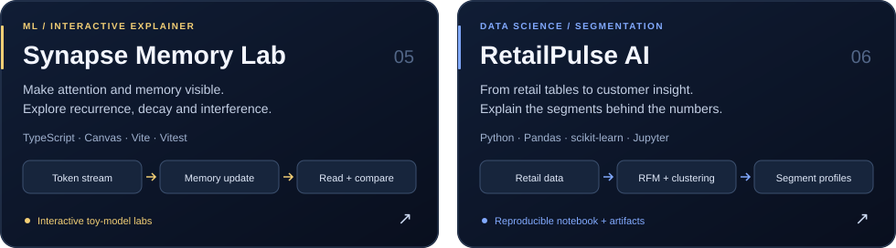</picture>

<a href="https://github.com/ISHPREET0101/synapse-memory-lab-dataforge-2026"><b>Synapse Memory Lab ↗</b></a> &nbsp; · &nbsp; <a href="https://github.com/ISHPREET0101/ML-PROJECT"><b>RetailPulse AI ↗</b></a>

  <a href="https://github.com/ISHPREET0101/BlockIT/releases/latest">Download BlockIT</a> &nbsp; · &nbsp;
  <a href="https://takumi-two-kohl.vercel.app/">Takumi sample demo</a> &nbsp; · &nbsp;
  <a href="https://ishpreet0101.github.io/synapse-memory-lab-dataforge-2026/">Explore Synapse Memory Lab</a>

## How the projects work

<picture><source media="(max-width: 600px)" srcset="assets/project-flows-mobile.svg" />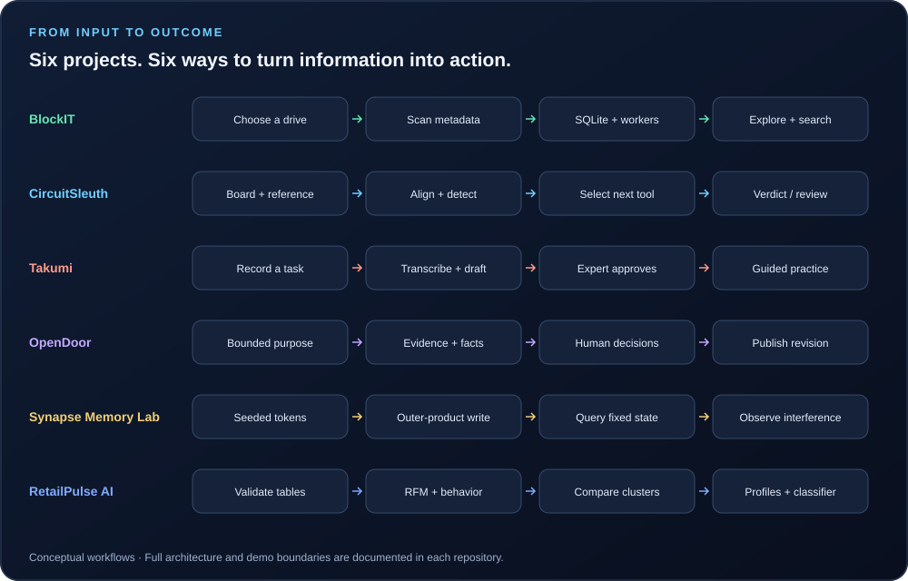</picture>

<b>Go deeper: architecture, design choices, and demo boundaries</b>

### [BlockIT](https://github.com/ISHPREET0101/BlockIT)

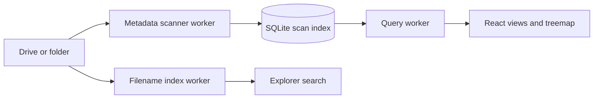

Scans file metadata; filename search does not inspect document contents.

### [CircuitSleuth](https://github.com/ISHPREET0101/circuitsleuth1)

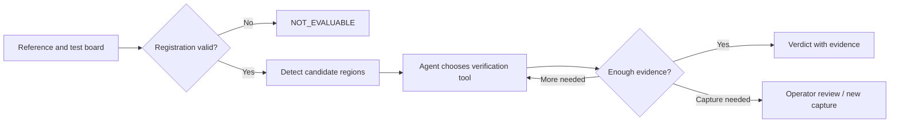

Collaborative project. Published benchmark uses seeded synthetic boards; it is not factory accuracy.

### [Takumi](https://github.com/ISHPREET0101/takumi)

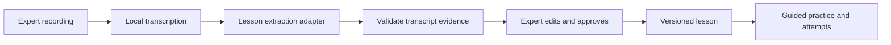

Hosted browser demo uses a bundled sample. Custom uploads and AI processing require the local backend.

### [OpenDoor](https://github.com/ISHPREET0101/opendoor-calle)

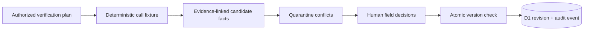

The demonstrated review flow uses simulated calls. Live CALL-E creation is not a validated end-to-end integration.

### [Synapse Memory Lab](https://github.com/ISHPREET0101/synapse-memory-lab-dataforge-2026)

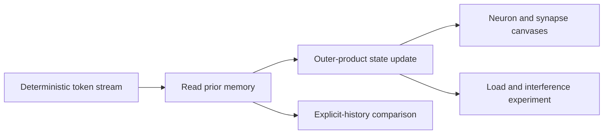

Collaborative educational toy simulations; no official BDH checkpoint or trained-model benchmark is run.

### [RetailPulse AI](https://github.com/ISHPREET0101/ML-PROJECT)

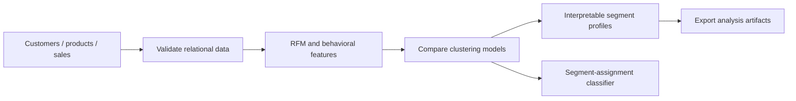

Classifier evaluation measures agreement with the selected segmentation model, not causal business lift.

## More builds & collaborations

| Project | What it explores | Stack / context |
| :--- | :--- | :--- |
| [DeltaProof](https://github.com/sgoel2be24-cyber/deltaproof) | Local semantic retrieval of scope clauses, cited evidence, and reviewer-driven cost/schedule simulation | Collaboration · TypeScript, MiniLM, Transformers.js, ONNX/WASM |
| [Teachable Voice](https://github.com/ISHPREET0101/prism-teachable-voice) | Teach an Android task by demonstration, then replay it from a spoken command | Team project · Android, Kotlin, accessibility APIs |
| [JOY PITWALL](https://github.com/ISHPREET0101/joy-pitwall) | Offline race-weekend planning, stint logs, setup sheets, and engineering calculators | Electron, TypeScript · local data |
| [Aegis Alpha](https://github.com/ISHPREET0101/alpaca-AI-Hackathon) | Explainable options-agent architecture with deterministic risk gates and an audit trail | Python, SQLite, Streamlit · paper trading only |

<b>Browse the wider project shelf</b>

- [Multimodal Sentiment Analysis](https://github.com/ISHPREET0101/Multimodel-Sentiment-Analysis)
- [SmartCart](https://github.com/ISHPREET0101/SmartCart)
- [ShopIQ](https://github.com/ISHPREET0101/ShopIQ)
- [Loan Approval Project](https://github.com/ISHPREET0101/Loan-Approval-Project)
- [AQI Project](https://github.com/ISHPREET0101/AQI-PROJECT)
- [Portfolio Risk Analyzer](https://github.com/ISHPREET0101/portfolio-risk-analyzer)
- [Ecommerce](https://github.com/ISHPREET0101/Ecommerce)
- [Mental Health Support System](https://github.com/ISHPREET0101/Mental-Health-Support-System)
- [AI Lab Experiments](https://github.com/ISHPREET0101/AI-Lab-Experiments)
- [JavaScript Projects](https://github.com/ISHPREET0101/JS-projects)

[View all public repositories →](https://github.com/ISHPREET0101?tab=repositories&type=public)

## Learning & milestones

**Finalist — DATA FORGE, IIT Kharagpur** · [Synapse Memory Lab](https://github.com/ISHPREET0101/synapse-memory-lab-dataforge-2026)

**Machine Learning Specialization coursework — DeepLearning.AI & Stanford Online, via Coursera**

| Course | Credential |
| :--- | :--- |
| Supervised Machine Learning: Regression and Classification | [May 2026 ↗](https://coursera.org/verify/PYVPJPP6KXGL) |
| Advanced Learning Algorithms | [August 2026 ↗](https://coursera.org/verify/LYUZK160D8N7) |
| Unsupervised Learning, Recommenders, Reinforcement Learning | [August 2026 ↗](https://coursera.org/verify/PBVJQMLLHWXM) |

  

  <a href="https://www.linkedin.com/in/ishpreet-singh-351224322">LinkedIn</a> ·
  <a href="https://github.com/ISHPREET0101?tab=repositories">Explore my repositories</a>

